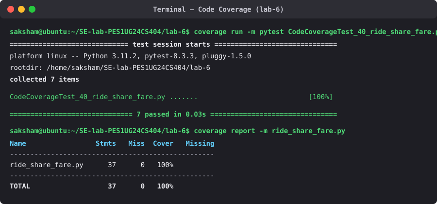

# Lab 6: Code and Branch Coverage Analysis (`ride_share_fare`)

## Deliverables

- `ride_share_fare.py` — Application module under test
- `CodeCoverageTest_40_ride_share_fare.py` — Test cases achieving 100% Line (Code) Coverage
- `BranchCoverageTest_40_ride_share_fare.py` — Test cases achieving 100% Branch Coverage

## 1. Code (Line) Coverage Terminal Output (100%)

## 2. Branch Coverage Terminal Output (100%)

